# Architecture Whitepaper

## Ahmed Khaled — Technical Operations Portfolio

**Version:** 1.0.0  
**Status:** Production  
**Deployment:** Cloudflare Pages  
**Repository:** [Ahmedbakr78/ahmed-khaled-technical-operations-portfolio](https://github.com/Ahmedbakr78/ahmed-khaled-technical-operations-portfolio)

This whitepaper documents how the portfolio is structured as an engineering system. It covers the runtime architecture, component boundaries, state model, rendering and audio pipelines, the project lifecycle simulator, delivery controls, security posture and the decisions that keep the application static, private and reproducible.

---

## 1. Design Goals

The application is intentionally not a generic template. It is a professional engineering artefact with five explicit goals.

| Goal | Design decision | Verification |
|:---|:---|:---|
| Fast first render | Static Vite bundle, no backend, preconnected fonts | Build output and Lighthouse review |
| Privacy by default | No analytics, cookies, remote APIs or session storage | Source review and network inspection |
| Deterministic content | One typed dataset drives every section | TypeScript checks and unit tests |
| Operational credibility | Project lifecycle simulator, QC gates, BOQ flow and RFI workflow | Manual QA matrix |
| Reproducible delivery | Documented build, CI quality gate and Cloudflare deployment | CI workflow and deployment guide |

### Non-goals

- Server-side authentication or private dashboards.
- Storing visitor messages in a database.
- Tracking, advertising or behavioural analytics.
- Multi-tenant content management.
- Replacing a full project controls platform such as Primavera or MS Project.

---

## 2. System Context

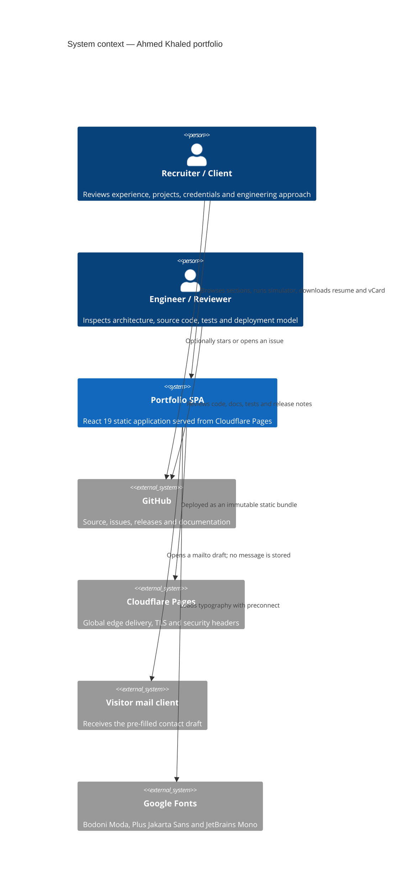

The portfolio has no application server. The only runtime dependencies are the static host, the visitor's browser, Google Fonts and the visitor's mail client.

---

## 3. Container and Component Architecture

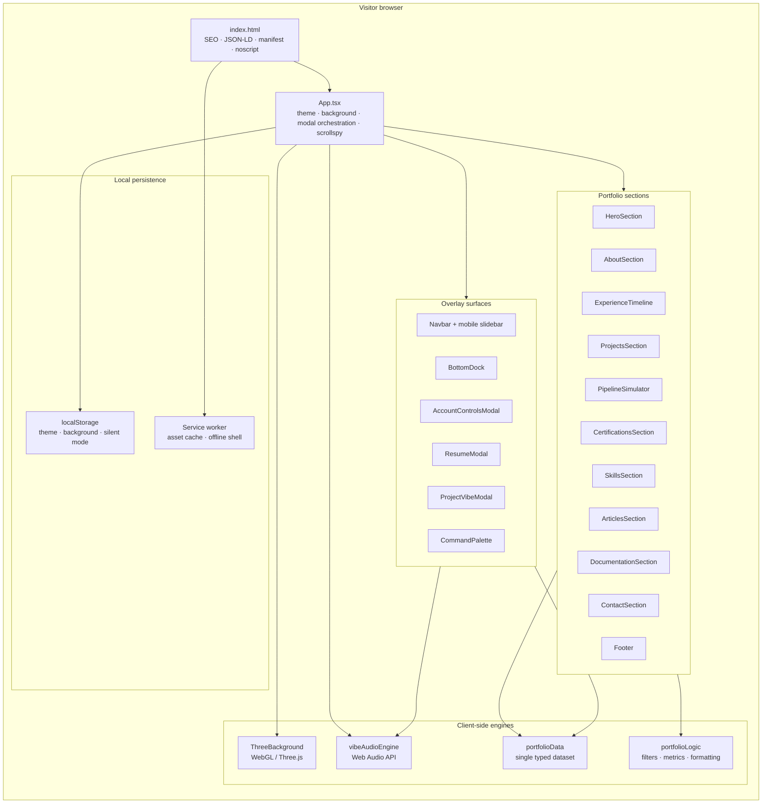

### Component responsibilities

| Component | Responsibility | State ownership |
|:---|:---|:---|
| `App.tsx` | Global theme, background style, silent mode, modal routing, scrollspy, audio mix | Global UI state |
| `Navbar.tsx` | Desktop pill navigation, mobile slidebar, Dynamic Island audio controller | Local open/scroll state |
| `HeroSection.tsx` | Identity, availability, direct channels, key metrics | None |
| `AboutSection.tsx` | Engineering philosophy, competencies, workflow blueprints, training and roadmap | Active blueprint tab |
| `ExperienceTimeline.tsx` | Professional experience and achievements | None |
| `ProjectsSection.tsx` | Deliverable cards, filtering, search and project blueprint modal | Filter and search |
| `PipelineSimulator.tsx` | Five-stage lifecycle simulation, QC audit, telemetry and audit query | Simulation state |
| `CertificationsSection.tsx` | Credential explorer and category filters | Filter state |
| `SkillsSection.tsx` | Six-domain competency matrix | None |
| `ArticlesSection.tsx` | Long-form engineering articles and reader modal | Selected article |
| `DocumentationSection.tsx` | Repository, release, documentation and recruiter FAQ hub | Open FAQ |
| `ContactSection.tsx` | Contact channels, vCard and mailto draft | Form state |
| `ThreeBackground.tsx` | Autonomous WebGL background with rendering presets | Animation state |
| `CommandPalette.tsx` | Keyboard-first search and actions | Query state |
| `vibeAudioEngine.ts` | Procedural 84-sound mixer | Audio graph state |

---

## 4. Runtime Data Flow

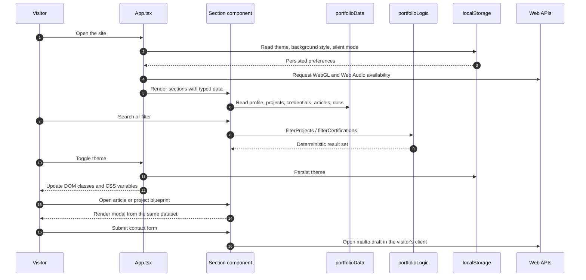

There is no remote data fetch after the initial asset load. Content changes are made in `src/data/portfolioData.ts`, checked by TypeScript and shipped in the next build.

---

## 5. State Model

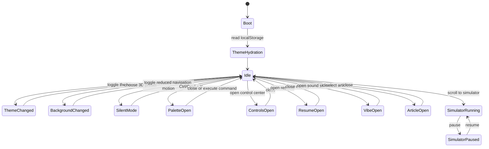

### Persisted keys

| Key | Type | Purpose |
|:---|:---|:---|
| `portfolio-theme` | `"dark" \| "light"` | Onyx Dark or Minimal White |
| `portfolio-bg-style` | `"constellation" \| "wave" \| "grid" \| "polyhedra" \| "minimal"` | Three.js rendering preset |
| `portfolio-silent-mode` | `"true" \| "false"` | Instant navigation instead of smooth scrolling |

No personal data, contact form content or audio state is persisted.

---

## 6. Section and Navigation Map

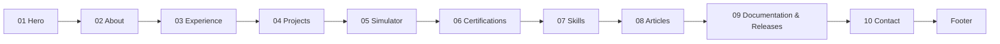

The navbar, bottom dock and scrollspy share the same section identifiers. The command palette can jump directly to any registered section, open the simulator, download the resume or switch theme.

---

## 7. Project Lifecycle Simulator

The simulator is a deterministic, client-side state machine that demonstrates how a project moves from scope definition to handover.

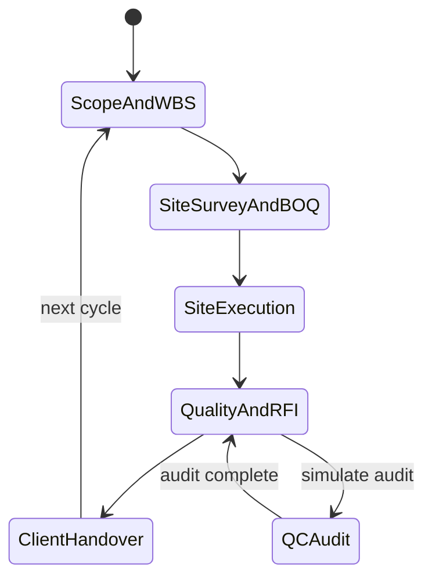

| Stage | Displayed controls | Engineering meaning |
|:---|:---|:---|
| 1. Scope & WBS | Completion, deliverables, schedule | Scope baseline and work packages |
| 2. Site Survey & BOQ | Quantity take-offs, cost baseline | Measurement and pricing |
| 3. Site Execution | Daily logs, subcontractor alignment | Field coordination |
| 4. Quality & RFI | QC score, RFI approvals | Inspection and technical closure |
| 5. Client Handover | 100% completion, sign-off | Closeout and acceptance |

The simulator uses local timers and state only. It does not call an API, write to storage or claim to be a live project system.

---

## 8. Three.js Rendering Pipeline

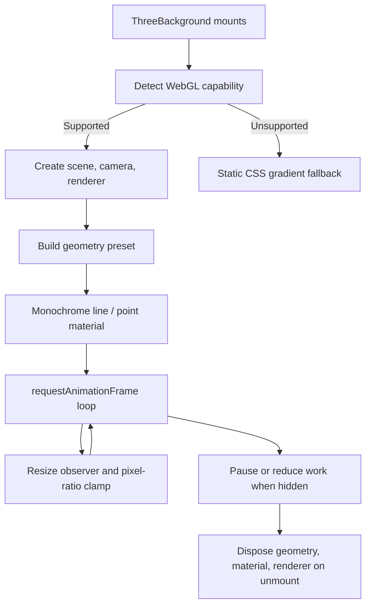

### Rendering controls

- Five presets: constellation, flowing wave, architectural grid, wireframe polyhedra and minimal.
- Monochrome palette to preserve the editorial design language.
- Device pixel ratio is clamped to protect high-DPI mobile devices.
- Animation pauses when the document is hidden.
- Geometry and materials are disposed on unmount to prevent GPU memory leaks.

---

## 9. Web Audio Engine

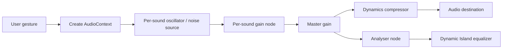

### Audio design rules

1. Audio starts only after an explicit user gesture, in line with browser autoplay policies.
2. Each of the 84 sounds is generated procedurally; no external audio assets are downloaded.
3. Sounds are mixed through independent gain nodes so multiple layers can coexist.
4. A master gain and compressor protect the listener from clipping.
5. The engine can stop all nodes, clear the mix and rebuild a preset without reloading the page.
6. Audio state is session-only and is not persisted.

---

## 10. Command Palette Interaction

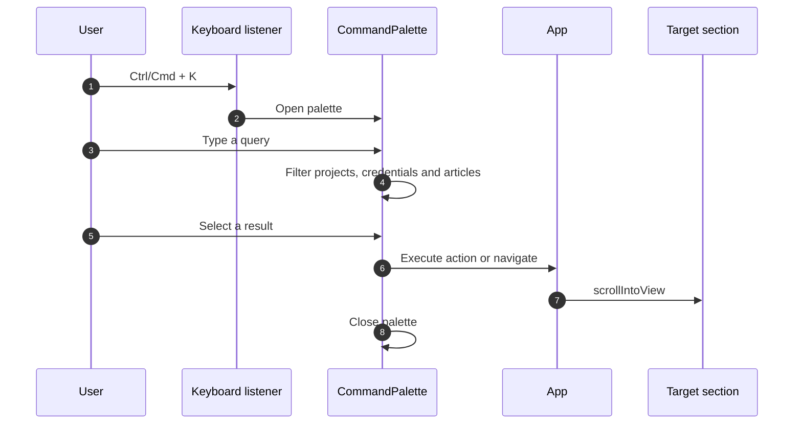

The palette is an accessibility and productivity feature, not a hidden router. All destinations are real sections or modal actions.

---

## 11. SEO, PWA and Edge Delivery

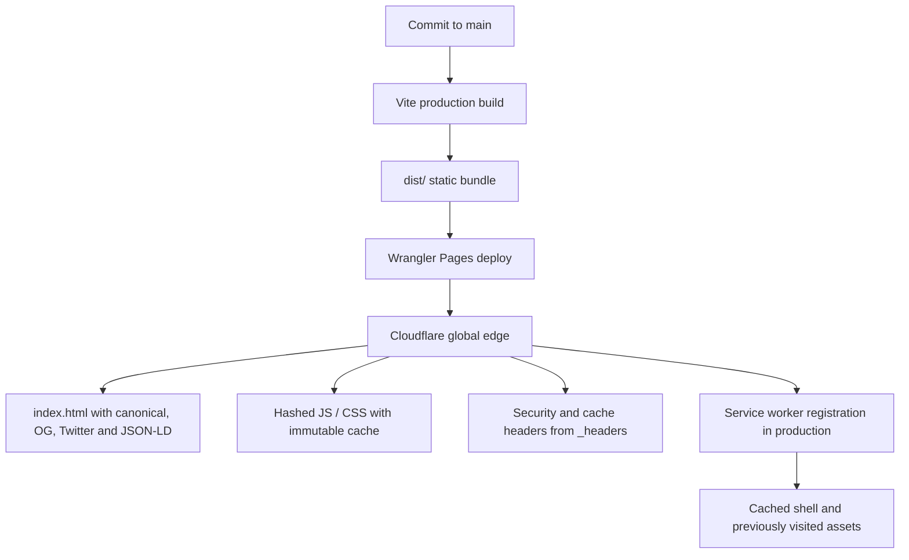

### Search and social metadata

- Canonical URL and Open Graph URL.
- 1200x630 social image with descriptive alt text.
- Twitter `summary_large_image` card.
- JSON-LD graph for `Person`, `WebSite` and `ProfilePage`.
- `robots.txt` and a single-URL `sitemap.xml`.
- Web app manifest with 192px and 512px icons plus shortcuts.

### Service worker policy

- Navigation requests use network-first with an offline shell fallback.
- Same-origin static assets use cache-first after the first fetch.
- The cache version is explicit; activation removes stale caches.
- Cross-origin requests are not intercepted.
- The service worker is registered only in production builds.

---

## 12. Security and Privacy Model

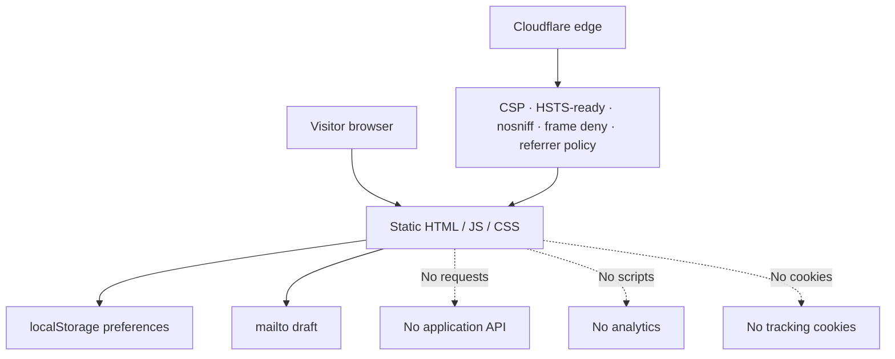

### Trust boundaries

| Boundary | Control |
|:---|:---|
| Browser to static host | HTTPS, TLS 1.3, HTTP/3, strict headers |
| Application to third parties | Only Google Fonts is loaded; no analytics or API calls |
| Contact flow | The browser opens the visitor's mail client; the site never receives the message |
| Local persistence | Preferences only; no personal data |
| Supply chain | Lockfile, Dependabot, CI, pinned GitHub Actions |

The contact email shown in the portfolio is a public contact channel, not a secret. No credentials, API keys or private tokens are required to build or run the application.

---

## 13. Testing and Quality Strategy

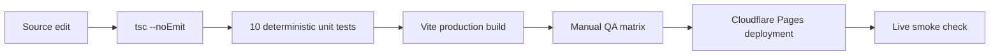

### Automated checks

- TypeScript strict compilation.
- Ten unit tests covering filters, statistics, credential formatting, scrollbar metrics, schema generation and motion variants.
- Production build must succeed.
- CI uploads the build artifact for inspection.

### Manual checks

- Both themes at desktop and mobile widths.
- Keyboard navigation and command palette.
- Simulator controls and QC audit.
- Audio play, pause, preset and volume.
- 3D preset switching and reduced-motion behaviour.
- Contact draft, vCard download and resume print.
- SEO metadata and social preview.
- Offline shell after first load.

Detailed procedures are in [Testing](docs/TESTING.md).

---

## 14. Deployment Topology

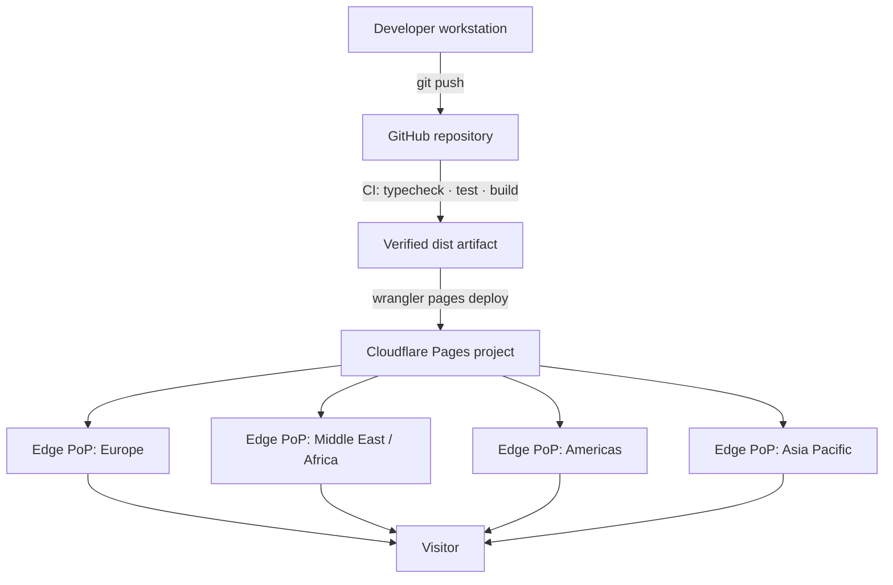

The production URL is:

**https://ahmed-khaled-technical-operations-portfolio.pages.dev**

Cloudflare Pages enforces the project name format: lowercase letters, numbers and hyphens. The requested display title "Ahmed Khaled — Technical Operations Portfolio" is therefore represented by the slug above. The human-readable title is used in the page `<title>`, Open Graph metadata and repository description.

---

## 15. Architecture Decision Records

| ID | Decision | Rationale | Trade-off |
|:---|:---|:---|:---|
| ADR-001 | Static SPA over SSR | Zero backend, low operating cost, strong privacy | No server-side personalisation |
| ADR-002 | Single typed data module | One source of truth, easy review, deterministic rendering | Content edits require a rebuild |
| ADR-003 | React 19 + Vite 8 | Fast iteration and modern concurrent rendering | Large client bundle requires monitoring |
| ADR-004 | Tailwind CSS v4 | Consistent design tokens and rapid UI composition | Utility-heavy markup |
| ADR-005 | Three.js background | Distinctive visual identity without image assets | GPU cost on low-end devices |
| ADR-006 | Procedural Web Audio | 84 sounds with no audio downloads | Audio quality is intentionally synthetic |
| ADR-007 | localStorage for preferences | Simple, private, no account system | Preferences do not follow the visitor across devices |
| ADR-008 | Cloudflare Pages | Global edge, free TLS, simple immutable deploys | Platform-specific deployment configuration |
| ADR-009 | No analytics | Privacy and trust | No built-in visitor behaviour metrics |
| ADR-010 | Mailto contact flow | No server, no stored messages | Depends on the visitor having a mail client |

---

## 16. Extending the System

### Adding a section

1. Add the component under `src/components/`.
2. Add the section identifier to the scrollspy list in `App.tsx`.
3. Add the navigation item to `Navbar.tsx` and optionally `BottomDock.tsx`.
4. Add a command palette action if the section is a primary destination.
5. Add the section to the README feature map and `docs/FEATURES.md`.
6. Run `npm run verify`.
7. Update the changelog and release notes.

### Adding a project, credential or article

1. Edit the typed collection in `src/data/portfolioData.ts`.
2. Keep identifiers unique and stable.
3. Add tags that are useful for search.
4. Verify the card layout at 320px, 768px and 1440px.
5. Run the quality gate.

### Adding a new 3D preset

1. Extend `BackgroundStyle` in `ThreeBackground.tsx`.
2. Add geometry and material setup for the preset.
3. Dispose all GPU resources on switch and unmount.
4. Add the option to `AccountControlsModal.tsx`.
5. Verify frame time and memory on a mobile viewport.

---

## 17. Known Constraints and Future Work

| Constraint | Current state | Planned direction |
|:---|:---|:---|
| Client bundle size | About 1.1 MB raw / 299 KB gzip | Route-level code splitting and deferred modal chunks |
| Automated browser tests | Manual QA matrix | Add Playwright smoke tests for core journeys |
| Contact form | Mailto draft | Optional serverless endpoint with spam protection if required |
| Content workflow | Typed source file | Optional MDX or CMS adapter without changing the UI contract |
| Analytics | None by design | Privacy-preserving aggregate metrics only if explicitly requested |
| Accessibility audit | Manual and keyboard review | Automated axe checks and formal WCAG 2.2 AA review |

---

## 18. Related Documentation

- [README](README.md) — executive overview and complete repository guide
- [Deployment](docs/DEPLOYMENT.md) — Cloudflare Pages operations
- [Features](docs/FEATURES.md) — 24-product capability matrix
- [Design System](docs/DESIGN_SYSTEM.md) — visual language and components
- [Testing](docs/TESTING.md) — automated and manual quality gates
- [Accessibility](docs/ACCESSIBILITY.md) — keyboard, motion and contrast standards
- [Performance](docs/PERFORMANCE.md) — budgets and optimization roadmap
- [SEO](docs/SEO.md) — metadata, structured data and social previews
- [Security](SECURITY.md) — trust model and disclosure policy
- [Changelog](CHANGELOG.md) — release history
