<div align="center">

# Ahmed Khaled — Technical Operations Portfolio

### Project Engineer · Technical Operations · Project Management

**A privacy-first, engineering-led portfolio for project delivery, site operations, BOQ estimation, quality assurance and AI-assisted workflows.**

**Egypt · Available for On-Site & Remote Technical Roles**

<br/>

[](https://ahmed-khaled-technical-operations-portfolio.pages.dev)
[](https://github.com/Ahmedbakr78/ahmed-khaled-technical-operations-portfolio/releases)
[](https://github.com/Ahmedbakr78/ahmed-khaled-technical-operations-portfolio/actions/workflows/ci.yml)
[](LICENSE)

<br/>

[](https://react.dev/)
[](https://www.typescriptlang.org/)
[](https://vite.dev/)
[](https://tailwindcss.com/)
[](https://threejs.org/)
[](https://nodejs.org/)
[](SECURITY.md)

<br/>

> **"Managing engineering project lifecycles from scope definition to final handover, with a verified 100% completion rate."**

</div>

---

## At a Glance

| | |
|:---|:---|
| **Live website** | [ahmed-khaled-technical-operations-portfolio.pages.dev](https://ahmed-khaled-technical-operations-portfolio.pages.dev) |
| **Source** | [github.com/Ahmedbakr78/ahmed-khaled-technical-operations-portfolio](https://github.com/Ahmedbakr78/ahmed-khaled-technical-operations-portfolio) |
| **Release** | [v1.0.0 — Foundation Release](https://github.com/Ahmedbakr78/ahmed-khaled-technical-operations-portfolio/releases/tag/v1.0.0) |
| **Hosting** | Cloudflare Pages · global edge · TLS 1.3 · HTTP/3 |
| **Stack** | React 19 · TypeScript 7 · Vite 8 · Tailwind CSS v4 · Motion · Three.js |
| **Architecture** | Static single-page application · no backend · no database · no analytics |
| **Quality** | Strict typecheck · 10 unit tests · production build · CI workflow |
| **License** | GNU Affero General Public License v3.0 |

---

## Live Preview

<div align="center">

[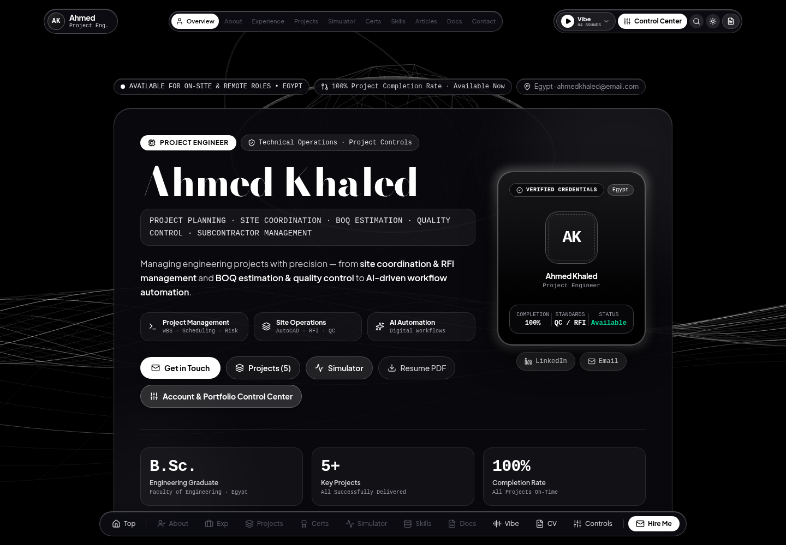](https://ahmed-khaled-technical-operations-portfolio.pages.dev)

<sub>Desktop preview · Onyx Dark theme · 1440px viewport</sub>

<br/>
<br/>

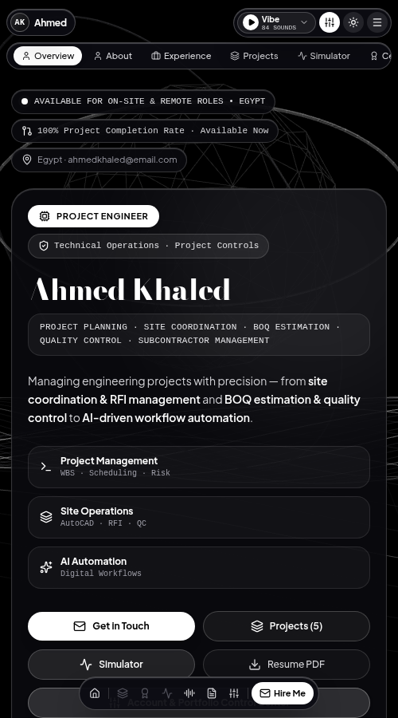

<sub>Mobile preview · 500px viewport · responsive navigation and dock</sub>

</div>

---

## Table of Contents

- [Professional Profile](#professional-profile)
- [Impact Metrics](#impact-metrics)
- [What This Repository Contains](#what-this-repository-contains)
- [Feature Matrix](#feature-matrix)
- [Engineering Domains](#engineering-domains)
- [Professional Experience](#professional-experience)
- [Selected Deliverables](#selected-deliverables)
- [Engineering Articles](#engineering-articles)
- [System Architecture](#system-architecture)
  - [System Context](#system-context)
  - [Component Architecture](#component-architecture)
  - [Runtime Flow](#runtime-flow)
  - [Project Lifecycle Simulator](#project-lifecycle-simulator)
  - [Deployment Pipeline](#deployment-pipeline)
  - [Security and Privacy Model](#security-and-privacy-model)
- [Technology Stack](#technology-stack)
- [Repository Structure](#repository-structure)
- [Documentation Index](#documentation-index)
- [Local Development](#local-development)
- [Quality Gate](#quality-gate)
- [Deployment](#deployment)
- [Performance, Accessibility and SEO](#performance-accessibility-and-seo)
- [Release History](#release-history)
- [Roadmap](#roadmap)
- [Frequently Asked Questions](#frequently-asked-questions)
- [Contributing](#contributing)
- [Security](#security)
- [License](#license)
- [Contact](#contact)

---

## Professional Profile

Analytical and detail-oriented Project Engineer based in Egypt with hands-on experience in project planning, site coordination and technical quality control. Experienced in managing project lifecycles from scope definition to final handover, maintaining a verified **100% completion rate** as a project owner.

The professional focus spans four connected areas:

1. **Project management and controls** — scope formulation, work breakdown structures, cost estimation, milestone tracking, resource allocation and risk management.
2. **Engineering and site operations** — AutoCAD drawing interpretation, site inspection, RFI management, material submittals, quality control and HSE compliance.
3. **Client and subcontractor management** — stakeholder communication, contract compliance, progress reporting and technical issue resolution.
4. **Digital workflows** — AI-assisted documentation, MS Project scheduling, technical proposal drafting and corporate training content.

The portfolio is designed around evidence rather than adjectives: every section maps a claim to a process, a metric, a workflow or a documented deliverable.

---

## Impact Metrics

| Metric | Value | Scope |
|:---|:---:|:---|
| **Project completion rate** | **100%** | Independent technical deliverables from scope to sign-off |
| **Quality and RFI compliance** | **100%** | Inspection records and technical query closure |
| **Core engineering disciplines** | **4** | Project · Site · Quality · Digital |
| **Key project deliverables** | **5** | Scope, site operations, BOQ, coordination, automation |
| **Credentials and training programs** | **10** | Project controls, QC, HSE, BOQ, AutoCAD, proposals |
| **Portfolio product features** | **24** | Interactive tools, content and accessibility controls |
| **Long-form engineering articles** | **9** | Lifecycle, quality, cost, AI, risk and handover |
| **Automated unit tests** | **10** | Deterministic logic and utility coverage |

---

## What This Repository Contains

This is not only a portfolio page. It is a complete, reproducible engineering artefact.

| Layer | Contents |
|:---|:---|
| **Professional profile** | Experience, projects, credentials, skills, training and roadmap |
| **Interactive engineering tools** | Lifecycle simulator, QC audit, BOQ and RFI blueprints |
| **Product experience** | Command palette, themes, 3D backgrounds, ambient audio, resume, vCard |
| **Documentation system** | Architecture, deployment, features, design system, testing, accessibility, performance, SEO, security, roadmap and FAQ |
| **Delivery system** | Vite build, CI quality gate, Cloudflare Pages deployment, security headers, service worker |
| **Repository governance** | Issue templates, pull request template, CODEOWNERS, Dependabot, security policy and code of conduct |

---

## Feature Matrix

### Profile and content

| Feature | Description |
|:---|:---|
| Executive hero | Identity, availability, direct channels and key metrics |
| About and philosophy | Four engineering pillars and an operations ecosystem |
| Experience timeline | Two professional engagements with evidence-oriented achievements |
| Project deliverables | Five case deliverables with metrics and architecture flows |
| Credentials | Ten certifications and training programs across six categories |
| Skills matrix | Six domains with eight competencies each |
| Articles | Nine long-form engineering articles with a reader modal |
| Documentation hub | Repository, release, docs and recruiter FAQ |

### Interactive engineering tools

| Feature | Description |
|:---|:---|
| Project lifecycle simulator | Five-stage state machine with run/pause and live telemetry |
| QC audit simulation | Inspection, status transitions and audit query |
| Delivery blueprints | Lifecycle, RFI, QC gates, BOQ and web architecture tabs |
| Command palette | `Ctrl/Cmd + K` search across projects, credentials and articles |
| ATS resume | Print-friendly curriculum vitae modal |
| vCard export | Downloadable contact card |
| Contact draft | Pre-filled mailto flow with no server-side storage |

### Experience and accessibility

| Feature | Description |
|:---|:---|
| Onyx Dark and Minimal White | Two complete monochrome themes |
| Five 3D presets | Constellation, wave, grid, polyhedra and minimal |
| 84-sound ambient studio | Procedural Web Audio mixer with presets and master volume |
| Dynamic Island | Live audio state, equalizer and quick mixer |
| Silent navigation | Reduced-motion-friendly instant section jumps |
| Mobile slidebar | Rounded floating drawer with section and audio controls |
| Scroll-reactive dock | Quick section shortcuts on desktop and mobile |
| Service worker | Offline shell and cached static assets |

---

## Engineering Domains

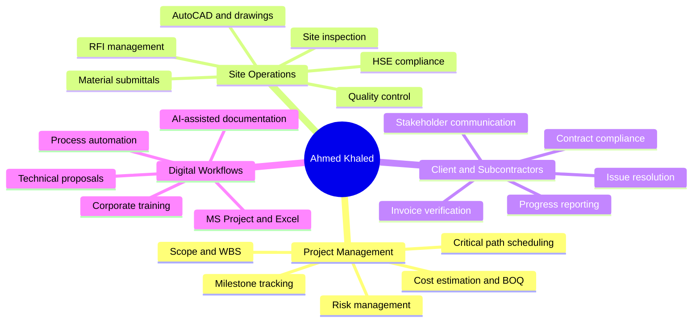

### What each domain means in practice

**Project management and controls.** Build a scope baseline, decompose it into work packages, assign owners and durations, track milestones, manage risk and compare planned progress with verified progress.

**Engineering and site operations.** Read the drawing correctly, inspect what was actually installed, verify material compliance, log the evidence and close technical queries through a controlled RFI process.

**Client and subcontractor management.** Make interfaces explicit, keep progress reporting honest, verify invoices against measured work and resolve blockers before they become delay.

**Digital workflows.** Use AI and office automation for structured, repetitive documentation while keeping engineering judgement and review accountability with the engineer.

---

## Professional Experience

### Project Engineer and Technical Operations Lead

**Engineering and Contracting Services — Egypt**  
*Present*

- Supervise daily engineering operations and align construction and installation activities with technical specifications and safety standards.
- Prepare and process engineering documentation including RFIs, inspection requests and daily progress logs.
- Conduct site surveys, perform material quantity take-offs and verify contractor invoices against completed milestones.
- Coordinate multidisciplinary engineering teams, clients and consultants to clear technical hurdles and reduce schedule slippage.
- Manage subcontractor supervision and enforce quality control standards across site activities.
- Develop BOQ estimations and technical proposals for engineering scopes.

### Freelance Project Owner and Coordinator

**Project Services — Egypt**  
*Ongoing*

- Directed independent technical deliverables from scope formulation to successful sign-off with a 100% completion rate.
- Evaluated project requirements, assigned technical tasks and enforced quality control standards.
- Managed client communications, contract terms and progress updates for transparent execution.
- Integrated AI-assisted process automation to improve workflow efficiency and reporting.
- Developed corporate training content and technical proposals for client engagements.

---

## Selected Deliverables

| Deliverable | Discipline | Focus | Evidence |
|:---|:---|:---|:---|
| **Technical Scope and Deliverables Execution** | Project Management | Full lifecycle delivery | 100% completion across milestones within budget caps |
| **Site Operations and Engineering Supervision** | Site Operations | Quality and safety | Daily RFI and inspection logs; zero critical compliance violations |
| **BOQ and Cost Estimation System** | Cost Estimation | Take-offs and valuation | Invoice verification against validated site milestones |
| **Cross-Functional Project Coordination** | Coordination | Multidisciplinary liaison | Consultant, client and field team alignment |
| **AI-Driven Engineering Workflow Automation** | Automation | Process efficiency | Automated documentation templates and reporting workflows |

Each deliverable is presented in the portfolio with a summary, long-form context, tags, metrics and an architecture flow.

---

## Engineering Articles

The portfolio includes nine long-form articles:

1. **Full Lifecycle Project Management** — scope formulation to handover.
2. **Quality Assurance on Active Sites** — achieving zero non-conformances.
3. **Precision in BOQ** — preventing cost overruns.
4. **AI Tool Integration** — governance-first automation.
5. **Subcontractor Performance** — coordination and contract discipline.
6. **HSE Culture** — proactive safety on site.
7. **Earned Value and Schedule Variance** — reading project health early.
8. **Digital Handover** — building an as-built dossier without chaos.
9. **Risk Registers That Actually Reduce Risk** — from spreadsheet to decision tool.

Each article is rendered in an accessible reader modal with tags, metadata and sharing.

---

## System Architecture

### System Context

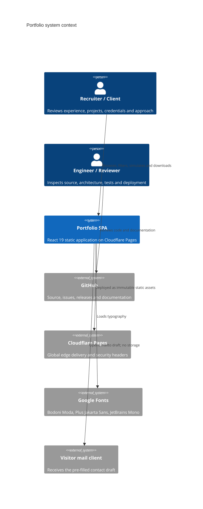

### Component Architecture

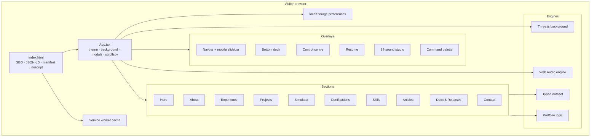

### Runtime Flow

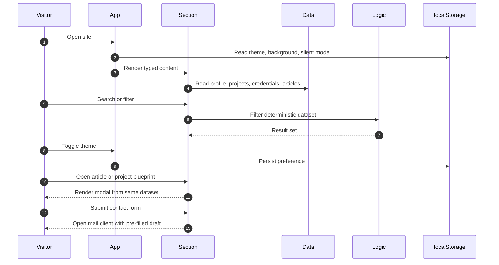

### Project Lifecycle Simulator

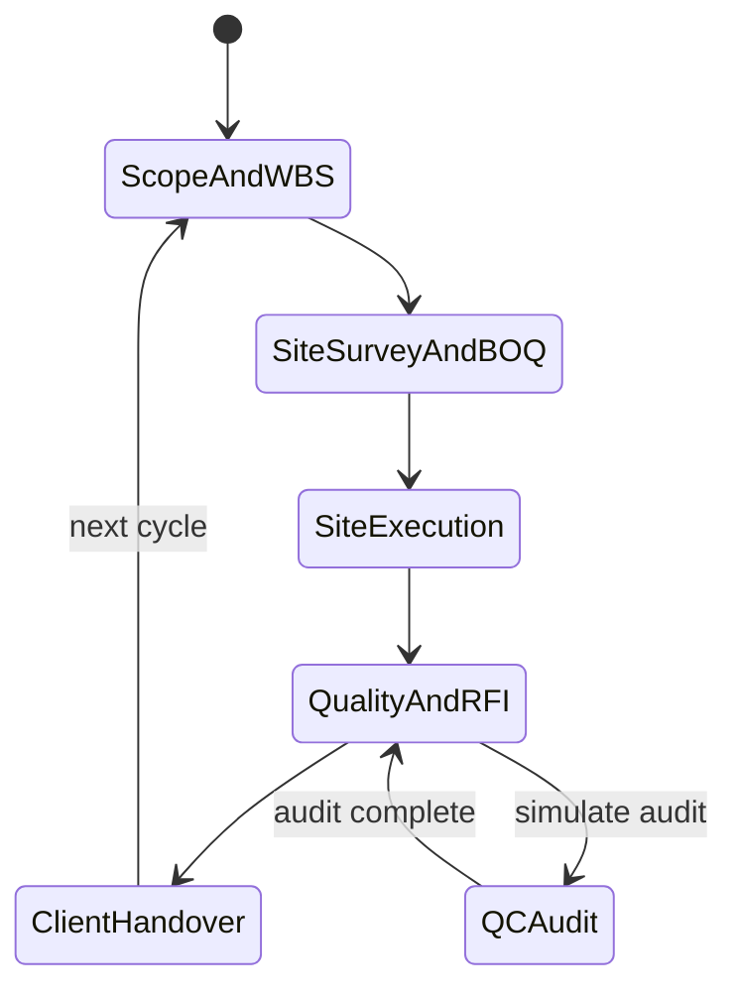

The simulator demonstrates the delivery model used throughout the portfolio:

| Stage | Control | Evidence |
|:---|:---|:---|
| 1. Scope and WBS | Deliverables, exclusions, acceptance criteria | Scope baseline and work packages |
| 2. Site survey and BOQ | Quantities, rates, cost baseline | Measurement sheets and cost plan |
| 3. Site execution | Daily supervision and trade coordination | Progress logs and inspection requests |
| 4. Quality and RFI | ITP hold points and technical closure | QC records and approved RFIs |
| 5. Client handover | Snag closeout and as-built dossier | Signed acceptance and final invoice |

### Deployment Pipeline

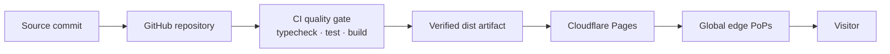

### Security and Privacy Model

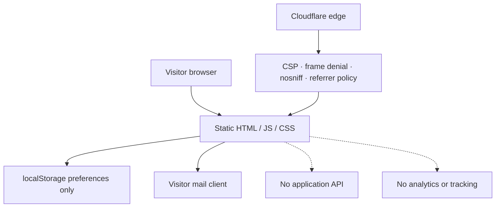

- No backend, database, cookies or analytics.
- Preferences are stored only in `localStorage`.
- The contact form opens a pre-filled mail draft in the visitor's own client.
- Cloudflare Pages applies strict security and cache headers.
- The service worker is same-origin, versioned and network-first for navigation.

The full architectural rationale, state model, rendering pipeline, audio graph and decision records are in [ARCHITECTURE.md](ARCHITECTURE.md).

---

## Technology Stack

| Layer | Technology | Why it is used |
|:---|:---|:---|
| UI runtime | React 19 | Concurrent rendering and component composition |
| Language | TypeScript 7 | Strict typing for data and logic |
| Build | Vite 8 | Fast development and optimized static output |
| Styling | Tailwind CSS v4 | Design tokens and utility composition |
| Animation | Motion | Spring-based interface transitions |
| 3D | Three.js | Autonomous WebGL background |
| Audio | Web Audio API | 84 procedural sounds with no assets |
| Icons | Lucide React | Consistent accessible icon system |
| Hosting | Cloudflare Pages | Global edge, TLS and immutable assets |
| Quality | Node test runner + tsx | Deterministic unit tests |
| CI | GitHub Actions | Typecheck, test and build on every push |
| Documentation | Markdown + Mermaid | Versioned, reviewable diagrams |

---

## Repository Structure

```text
.
├── .github/
│   ├── CODEOWNERS
│   ├── ISSUE_TEMPLATE/
│   │   ├── bug_report.yml
│   │   ├── config.yml
│   │   └── feature_request.yml
│   ├── PULL_REQUEST_TEMPLATE.md
│   ├── dependabot.yml
│   └── workflows/
│       └── ci.yml
├── docs/
│   ├── assets/
│   │   ├── portfolio-desktop.png
│   │   └── portfolio-mobile.png
│   ├── ACCESSIBILITY.md
│   ├── DEPLOYMENT.md
│   ├── DESIGN_SYSTEM.md
│   ├── FAQ.md
│   ├── FEATURES.md
│   ├── PERFORMANCE.md
│   ├── README.md
│   ├── RELEASE_NOTES_v1.0.0.md
│   ├── ROADMAP.md
│   ├── SEO.md
│   └── TESTING.md
├── public/
│   ├── 404.html
│   ├── _headers
│   ├── apple-touch-icon.png
│   ├── favicon-32x32.png
│   ├── favicon.svg
│   ├── icon-192.png
│   ├── icon-512.png
│   ├── og-image.png
│   ├── robots.txt
│   ├── site.webmanifest
│   ├── sitemap.xml
│   └── sw.js
├── src/
│   ├── App.tsx
│   ├── main.tsx
│   ├── index.css
│   ├── components/
│   │   ├── AboutSection.tsx
│   │   ├── AccountControlsModal.tsx
│   │   ├── ArticlesSection.tsx
│   │   ├── BottomDock.tsx
│   │   ├── CertificationsSection.tsx
│   │   ├── CommandPalette.tsx
│   │   ├── ContactSection.tsx
│   │   ├── DocumentationSection.tsx
│   │   ├── ExperienceTimeline.tsx
│   │   ├── Footer.tsx
│   │   ├── HeroSection.tsx
│   │   ├── Navbar.tsx
│   │   ├── PipelineSimulator.tsx
│   │   ├── ProjectVibeModal.tsx
│   │   ├── ProjectsSection.tsx
│   │   ├── ResumeModal.tsx
│   │   ├── SkillsSection.tsx
│   │   └── ThreeBackground.tsx
│   ├── data/
│   │   └── portfolioData.ts
│   └── utils/
│       ├── motionVariants.ts
│       ├── portfolioLogic.test.ts
│       ├── portfolioLogic.ts
│       ├── studioAvatar.ts
│       └── vibeAudioEngine.ts
├── ARCHITECTURE.md
├── ACKNOWLEDGEMENTS.md
├── CHANGELOG.md
├── CODE_OF_CONDUCT.md
├── CONTRIBUTING.md
├── LICENSE
├── README.md
├── SECURITY.md
├── SUPPORT.md
├── index.html
├── metadata.json
├── package.json
├── package-lock.json
├── tsconfig.json
├── vite.config.ts
└── wrangler.toml
```

---

## Documentation Index

| Document | What it covers |
|:---|:---|
| [Architecture](ARCHITECTURE.md) | System context, components, state, rendering, audio, deployment, ADRs |
| [Deployment](docs/DEPLOYMENT.md) | Cloudflare Pages, CI, headers, caching, rollback, troubleshooting |
| [Features](docs/FEATURES.md) | 24-feature matrix and interaction model |
| [Design System](docs/DESIGN_SYSTEM.md) | Colour, typography, surfaces, layout and motion |
| [Testing](docs/TESTING.md) | Unit tests, QA matrix, browser support and release checklist |
| [Accessibility](docs/ACCESSIBILITY.md) | WCAG 2.2 AA approach, keyboard map and limitations |
| [Performance](docs/PERFORMANCE.md) | Build profile, budgets, optimizations and measurement |
| [SEO](docs/SEO.md) | Metadata, JSON-LD, social previews and technical checklist |
| [Roadmap](docs/ROADMAP.md) | Release train and prioritized work |
| [FAQ](docs/FAQ.md) | Recruiter and technical questions |
| [Release Notes](docs/RELEASE_NOTES_v1.0.0.md) | v1.0.0 foundation release |
| [Security](SECURITY.md) | Trust model and responsible disclosure |
| [Contributing](CONTRIBUTING.md) | Local workflow and standards |
| [Code of Conduct](CODE_OF_CONDUCT.md) | Community expectations |
| [Support](SUPPORT.md) | Where to ask for help |
| [Changelog](CHANGELOG.md) | Release history |
| [Acknowledgements](ACKNOWLEDGEMENTS.md) | Credits and dependencies |

---

## Local Development

### Prerequisites

- Node.js 22.x LTS
- npm 10.x or newer
- A modern browser with WebGL and Web Audio support for the full experience

### Install and run

```bash
git clone https://github.com/Ahmedbakr78/ahmed-khaled-technical-operations-portfolio.git
cd ahmed-khaled-technical-operations-portfolio
npm ci
npm run dev
```

Open `http://localhost:3000`.

### Available scripts

| Script | Purpose |
|:---|:---|
| `npm run dev` | Start the Vite development server |
| `npm run build` | Build the production bundle into `dist/` |
| `npm run preview` | Preview the production build locally |
| `npm run lint` | Run the TypeScript typecheck |
| `npm test` | Run the 10 unit tests |
| `npm run verify` | Typecheck, test and build in sequence |
| `npm run deploy` | Build and deploy to Cloudflare Pages |
| `npm run clean` | Remove build artifacts |

---

## Quality Gate

```bash
npm run verify
```

The gate runs:

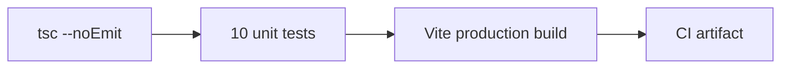

Current status:

- TypeScript: no errors.
- Tests: 10 passed, 0 failed.
- Production build: successful.
- CI: GitHub Actions workflow on push and pull request.

The manual QA matrix covers both themes, mobile layouts, keyboard navigation, audio gestures, 3D presets, contact draft, resume print and live smoke checks. See [docs/TESTING.md](docs/TESTING.md).

---

## Deployment

### Production

- **Platform:** Cloudflare Pages
- **Project:** `ahmed-khaled-technical-operations-portfolio`
- **URL:** https://ahmed-khaled-technical-operations-portfolio.pages.dev
- **Production branch:** `main`
- **Build command:** `npm run build`
- **Output directory:** `dist`

### CLI deployment

```bash
npm run build
npx wrangler pages deploy dist \
  --project-name ahmed-khaled-technical-operations-portfolio \
  --branch main \
  --commit-dirty=true
```

### Project naming note

Cloudflare Pages subdomains accept lowercase letters, numbers and hyphens only. The requested display title **"Ahmed Khaled — Technical Operations Portfolio"** is therefore represented by the canonical slug:

```text
ahmed-khaled-technical-operations-portfolio.pages.dev
```

The human-readable title is preserved in the page `<title>`, Open Graph metadata, manifest and repository description.

The full deployment, rollback, custom-domain and troubleshooting guide is in [docs/DEPLOYMENT.md](docs/DEPLOYMENT.md).

---

## Performance, Accessibility and SEO

### Performance

| Asset | Raw | Gzip |
|:---|:---:|:---:|
| HTML | ~7.9 KB | ~2.1 KB |
| CSS | ~67 KB | ~11 KB |
| JavaScript | ~1.13 MB | ~299 KB |

The initial bundle is within the documented budget. Code splitting, lazy loading of the audio studio and Three.js, and Lighthouse CI are the next performance milestones. See [docs/PERFORMANCE.md](docs/PERFORMANCE.md).

### Accessibility

- Keyboard-reachable controls and visible focus states.
- Accessible names for icon-only buttons.
- `aria-expanded` on the FAQ accordion.
- Reduced-motion-friendly silent navigation.
- High-opacity glass surfaces for legibility.
- Both themes reviewed at desktop and mobile widths.
- Known limitation: a shared focus-trap utility is planned. See [docs/ACCESSIBILITY.md](docs/ACCESSIBILITY.md).

### SEO

- Canonical URL and Open Graph metadata.
- 1200x630 social image.
- JSON-LD graph for `Person`, `WebSite` and `ProfilePage`.
- `robots.txt` and `sitemap.xml`.
- Web app manifest with icons and shortcuts.
- Branded 404 page.
- No tracking or advertising scripts. See [docs/SEO.md](docs/SEO.md).

---

## Release History

### v1.0.0 — Foundation Release · 26 October 2026

- Complete React 19 portfolio with ten sections.
- Project lifecycle simulator, QC audit and engineering blueprints.
- 84-sound ambient studio and five 3D presets.
- Command palette, ATS resume, vCard and contact draft.
- Documentation and release hub.
- Full documentation suite and CI quality gate.
- Cloudflare Pages deployment with security headers and service worker.

Read the full [v1.0.0 release notes](docs/RELEASE_NOTES_v1.0.0.md) or the [changelog](CHANGELOG.md).

---

## Roadmap

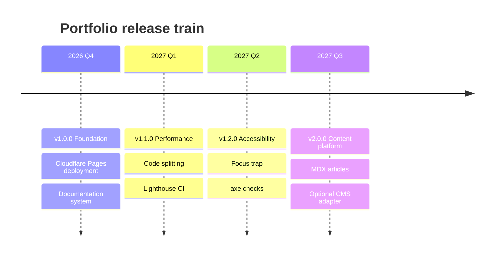

Priority order:

1. Accessibility and correctness.
2. Privacy and security.
3. Performance and reliability.
4. Content clarity for recruiters and clients.
5. New interactive features.
6. Cosmetic enhancements.

See [docs/ROADMAP.md](docs/ROADMAP.md).

---

## Frequently Asked Questions

**Is this a static site?**  
Yes. It is a React single-page application deployed as static files on Cloudflare Pages. There is no application server or database.

**Does the site use analytics?**  
No. There are no analytics scripts, tracking cookies or advertising pixels. Preferences are stored only in `localStorage`.

**How does the contact form work?**  
It opens a pre-filled email draft in the visitor's mail client. The site does not receive or store the message.

**What happens if WebGL or audio is unavailable?**  
The site remains fully usable. The 3D background and audio studio are progressive enhancements.

**Why is the bundle relatively large?**  
The initial release ships React, Motion, Three.js, icons and the complete application in one bundle. Code splitting is the next performance milestone.

**Where is the architecture documented?**  
See [ARCHITECTURE.md](ARCHITECTURE.md), [docs/DEPLOYMENT.md](docs/DEPLOYMENT.md) and the rest of the [documentation index](docs/README.md).

More questions are answered in [docs/FAQ.md](docs/FAQ.md).

---

## Contributing

Contributions are welcome when they improve correctness, accessibility, performance, documentation or the professional presentation of the portfolio.

Before opening a pull request:

```bash
npm ci
npm run lint
npm test
npm run build
```

Read [CONTRIBUTING.md](CONTRIBUTING.md) and [CODE_OF_CONDUCT.md](CODE_OF_CONDUCT.md).

---

## Security

Please report vulnerabilities privately through GitHub's security advisory flow. Do not open a public issue for a security problem.

- Trust model and controls: [SECURITY.md](SECURITY.md)
- Disclosure process: [SECURITY.md](SECURITY.md#reporting-a-vulnerability)
- Dependency updates: Dependabot
- CI verification: GitHub Actions

---

## License

This project is licensed under the **GNU Affero General Public License v3.0 (AGPL-3.0)**.

```text
Copyright (C) 2026 Ahmed Khaled.
Licensed under the GNU Affero General Public License v3.0.
```

See [LICENSE](LICENSE) for the complete terms. Third-party dependencies retain their own licenses.

---

## Contact

| Channel | Link |
|:---|:---|
| **Live portfolio** | [ahmed-khaled-technical-operations-portfolio.pages.dev](https://ahmed-khaled-technical-operations-portfolio.pages.dev) |
| **GitHub** | [github.com/Ahmedbakr78](https://github.com/Ahmedbakr78) |
| **LinkedIn** | [linkedin.com/in/ahmed-khaled-pe](https://linkedin.com/in/ahmed-khaled-pe) |
| **Email** | [ahmedbakr78102@gmail.com](mailto:ahmedbakr78102@gmail.com) |
| **Repository** | [ahmed-khaled-technical-operations-portfolio](https://github.com/Ahmedbakr78/ahmed-khaled-technical-operations-portfolio) |
| **Release** | [v1.0.0](https://github.com/Ahmedbakr78/ahmed-khaled-technical-operations-portfolio/releases/tag/v1.0.0) |

<div align="center">

**Built with React, TypeScript, Vite, Tailwind CSS, Motion, Three.js and the Web Audio API.**  
**Deployed on Cloudflare Pages. Documented for review. Designed for engineering delivery.**

</div>
