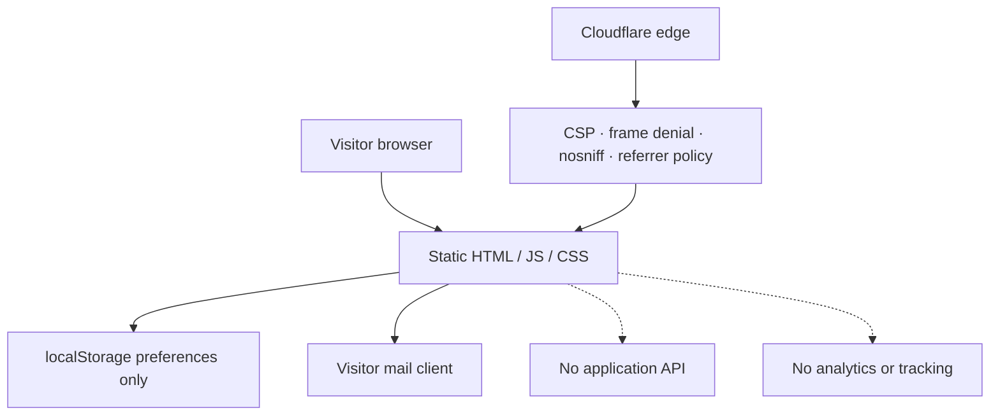

# Security Policy

## Supported Versions

| Version | Supported |
|:---|:---:|
| 1.x | Yes |
| < 1.0 | No |

---

## Reporting a Vulnerability

Please report security issues privately. Do not open a public issue for a vulnerability.

Use GitHub's private vulnerability reporting on the repository:

**https://github.com/Ahmedbakr78/ahmed-khaled-technical-operations-portfolio/security/advisories/new**

Include:

- A clear description of the issue.
- The affected version or commit.
- Reproduction steps or a proof of concept.
- Potential impact.
- Any suggested remediation.

You can expect an acknowledgement within 72 hours and a status update within 7 days. Please allow reasonable time for a fix before public disclosure.

---

## Scope

This policy covers the portfolio application and its deployment configuration.

### In scope

- Cross-site scripting or injection in the client application.
- Content Security Policy bypasses.
- Service worker cache poisoning or stale-content vulnerabilities.
- Supply-chain issues in the dependency graph.
- Exposure of secrets or private data in the repository.
- Clickjacking or framing weaknesses.
- Open redirects or unsafe external links.
- Dependency vulnerabilities with a realistic exploit path.

### Out of scope

- The public contact email or LinkedIn profile.
- Social engineering against the site owner.
- Denial of service through unrealistic traffic volumes.
- Vulnerabilities in Cloudflare's platform itself.
- Reports based only on automated scanner output without a demonstrated impact.
- The fictional or illustrative nature of portfolio metrics and training records.

---

## Security Architecture



### Controls

- Static hosting with no application server.
- Content Security Policy.
- `X-Frame-Options: DENY` and `frame-ancestors 'none'`.
- `X-Content-Type-Options: nosniff`.
- Referrer policy.
- Permissions policy for camera, microphone, geolocation and payment.
- Hashed immutable assets.
- No cookies, analytics or remote API calls.
- Contact flow opens the visitor's mail client; messages are not stored.
- Dependabot updates for npm and GitHub Actions.
- CI runs typecheck, tests and build.

---

## Secret Handling

The repository does not require runtime secrets. If Cloudflare deployment is automated through GitHub Actions, the following values must be stored as repository secrets and never committed:

- `CLOUDFLARE_API_TOKEN`
- `CLOUDFLARE_ACCOUNT_ID`

The default CI workflow does not deploy and does not require these secrets.

---

## Dependency Hygiene

```bash
npm audit
npm outdated
```

Dependabot opens grouped weekly updates. Review release notes and run the full quality gate before merging dependency changes.

---

## Responsible Disclosure

We will:

1. Acknowledge the report.
2. Investigate and reproduce the issue.
3. Prepare and test a fix.
4. Publish a release and advisory when appropriate.
5. Credit the reporter if they wish to be named.

Thank you for helping keep the project safe.
