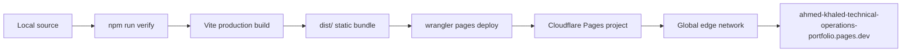

# Deployment Guide

## Cloudflare Pages Operations

This guide covers the production deployment of the Ahmed Khaled portfolio to Cloudflare Pages, including first-time setup, repeat deploys, rollback, headers, caching and troubleshooting.

---

## 1. Deployment Topology



The project is a static site. There is no Worker, database, KV namespace, D1 binding or runtime secret required.

---

## 2. Prerequisites

| Requirement | Version | Notes |
|:---|:---|:---|
| Node.js | 22.x LTS | Required by Wrangler 4 |
| npm | 10.x or newer | Uses `package-lock.json` |
| Wrangler | 4.x | Installed globally or via `npx` |
| Cloudflare account | Free or paid | Pages write permission required |
| Git | 2.30 or newer | Source control |

```bash
node --version
npm --version
npx wrangler --version
npx wrangler whoami
```

If Wrangler is not authenticated:

```bash
npx wrangler login
```

---

## 3. Local Verification

Always run the full quality gate before deploying.

```bash
npm ci
npm run lint
npm test
npm run build
npm run preview
```

The preview server runs at `http://localhost:4173` by default. Verify both themes, the mobile layout and the production service worker behaviour.

---

## 4. First-Time Project Creation

The Cloudflare Pages project name must be lowercase, may contain numbers and hyphens, and becomes the `*.pages.dev` subdomain. The requested human-readable title is:

**Ahmed Khaled — Technical Operations Portfolio**

Because spaces, em dashes and dots are not valid in a Pages subdomain, the canonical project slug is:

**ahmed-khaled-technical-operations-portfolio**

Create the project:

```bash
npx wrangler pages project create ahmed-khaled-technical-operations-portfolio --production-branch main
```

Confirm it exists:

```bash
npx wrangler pages project list
```

---

## 5. Production Deployment

```bash
npm run build
npx wrangler pages deploy dist \
  --project-name ahmed-khaled-technical-operations-portfolio \
  --branch main \
  --commit-dirty=true
```

The repository also exposes:

```bash
npm run deploy
```

Expected output includes a deployment URL and the production alias:

```text
https://ahmed-khaled-technical-operations-portfolio.pages.dev
```

---

## 6. Git-Integrated Deployments

Cloudflare Pages can also build from GitHub. If Git integration is enabled in the Cloudflare dashboard, use:

| Setting | Value |
|:---|:---|
| Framework preset | Vite |
| Build command | `npm run build` |
| Build output directory | `dist` |
| Node version | 22 |
| Production branch | `main` |

The repository includes `.nvmrc` and `package-lock.json` for reproducible builds. Run `npm ci` from the repository root so the lockfile is honored exactly.

### Optional GitHub Actions deployment

If you prefer CI-driven deployment, add a workflow with the following secrets:

| Secret | Purpose |
|:---|:---|
| `CLOUDFLARE_API_TOKEN` | Pages write token |
| `CLOUDFLARE_ACCOUNT_ID` | Cloudflare account ID |

Do not commit these values. The default repository workflow is intentionally limited to typecheck, test and build so that forks do not inherit deployment credentials.

---

## 7. Headers and Caching

`public/_headers` is copied into the build and interpreted by Cloudflare Pages.

| Path | Policy |
|:---|:---|
| `/*` | CSP, frame denial, nosniff, referrer policy, permissions policy |
| `/assets/*` | `max-age=31536000, immutable` |
| `/index.html` | `max-age=0, must-revalidate` |
| `/sw.js` | `max-age=0, must-revalidate` |
| `/og-image.png` | One-day cache |

Hashed Vite assets are safe to cache immutably. The HTML shell and service worker must revalidate so that new releases are discovered.

---

## 8. Service Worker and Release Propagation

The service worker uses a versioned cache name. When the cache name changes:

1. The new worker installs and calls `skipWaiting`.
2. Activation deletes old caches.
3. Clients claim the new worker.
4. Navigation requests continue to use network-first, so a fresh HTML shell is preferred when online.

When releasing a major change, increment `CACHE_NAME` in `public/sw.js`.

---

## 9. Rollback

### Dashboard rollback

Open the Pages project, select **Deployments**, choose the last known-good deployment and select **Rollback**.

### CLI rollback

Deploy a previous commit:

```bash
git checkout <known-good-commit>
npm ci
npm run build
npx wrangler pages deploy dist --project-name ahmed-khaled-technical-operations-portfolio --branch main
```

Return to `main` afterwards. Never force-push over release history.

---

## 10. Custom Domain

1. Open the Pages project in Cloudflare.
2. Select **Custom domains**.
3. Add the domain or subdomain.
4. Follow the DNS instructions.
5. Confirm TLS is active before sharing the URL.
6. Update the canonical URL, Open Graph URL, sitemap and JSON-LD if the primary domain changes.

The current canonical URL is the `pages.dev` address.

---

## 11. Post-Deployment Verification

```bash
curl -I https://ahmed-khaled-technical-operations-portfolio.pages.dev/
curl -s https://ahmed-khaled-technical-operations-portfolio.pages.dev/robots.txt
curl -s https://ahmed-khaled-technical-operations-portfolio.pages.dev/sitemap.xml
```

Manual checks:

- Hero renders and the Three.js background initializes.
- Theme toggle persists after reload.
- Command palette opens with `Ctrl/Cmd + K`.
- Simulator runs and the QC audit completes.
- Audio starts only after a user gesture.
- Resume modal prints cleanly.
- Contact form opens a pre-filled mail draft.
- Service worker registers in production.
- No console errors or failed network requests.

---

## 12. Troubleshooting

| Symptom | Likely cause | Resolution |
|:---|:---|:---|
| `wrangler` requires Node 22 | Older Node runtime | `nvm use 22` or install Node 22 |
| Project name rejected | Uppercase, spaces or invalid characters | Use lowercase letters, numbers and hyphens only |
| Blank page after deploy | Base path or asset path mismatch | Confirm Vite builds for `/` and inspect the console |
| Stale content | HTML or service worker cached | Hard reload, bump the service worker cache version |
| Fonts blocked | CSP or network policy | Confirm `fonts.googleapis.com` and `fonts.gstatic.com` are allowed |
| Audio does not start | No user gesture | Click Play; browsers block autoplay |
| 404 on a deep link | No SPA router is configured | Use the single-page anchors or add a redirect rule deliberately |
| CI fails during install | Node or lockfile mismatch | Confirm Node 22 is active and `npm ci` runs from the repository root |

---

## 13. Operational Checklist

- [ ] `npm run verify` passes locally.
- [ ] Build artifact contains `index.html`, `assets/`, `_headers`, `robots.txt`, `sitemap.xml`, `sw.js`, icons and `og-image.png`.
- [ ] Production URL responds with HTTP 200.
- [ ] Security headers are present.
- [ ] Social preview image loads.
- [ ] Service worker cache version is current.
- [ ] Release tag and notes are published.
- [ ] README and repository homepage point to the live URL.
