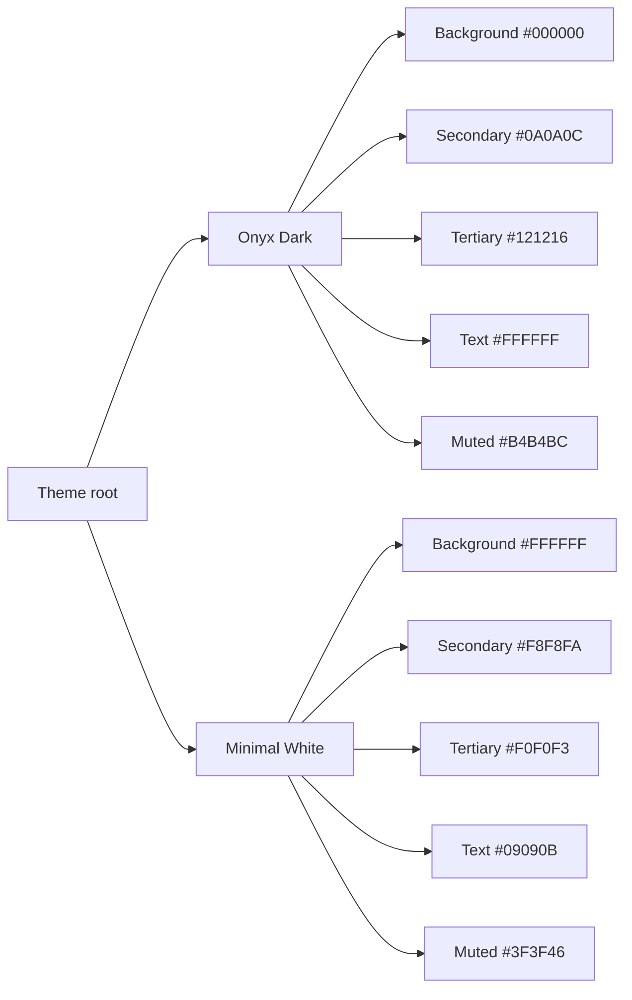
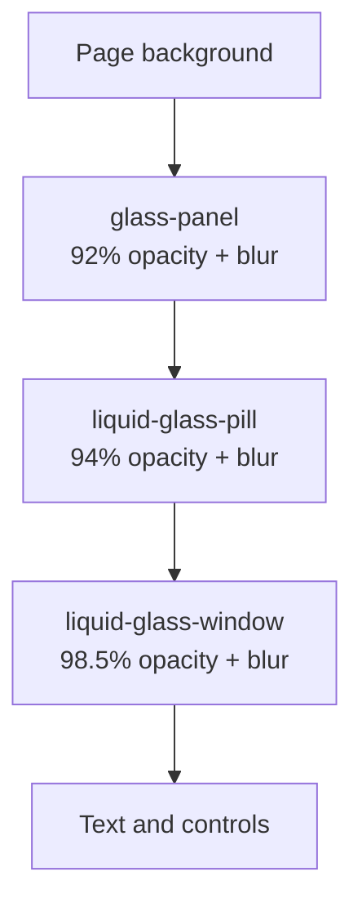

# Design System

## Monochrome Editorial Engineering

The visual language combines editorial typography with Apple-inspired liquid glass surfaces and a strict monochrome palette. The result is a portfolio that feels engineered rather than decorated.

---

## 1. Design Principles

1. **Monochrome first.** Hierarchy comes from type, spacing, opacity and elevation, not from colour noise.
2. **Crisp glass.** Panels use high opacity and controlled blur so text stays legible.
3. **Editorial scale.** Large serif display type creates a memorable identity; sans-serif body type carries detail.
4. **Motion with restraint.** Animation communicates state and hierarchy, never blocks reading.
5. **Evidence over ornament.** Numbers, diagrams and process flows are part of the interface.
6. **Accessible contrast.** Both themes are designed for readable text, not just visual effect.

---

## 2. Colour Tokens

| Token | Dark | Light | Use |
|:---|:---|:---|:---|
| `--bg-primary` | `#000000` | `#FFFFFF` | Page background |
| `--bg-secondary` | `#0A0A0C` | `#F8F8FA` | Raised surfaces |
| `--bg-tertiary` | `#121216` | `#F0F0F3` | Subtle panels |
| `--text-primary` | `#FFFFFF` | `#09090B` | Headings and key labels |
| `--text-secondary` | `#B4B4BC` | `#3F3F46` | Body copy |
| `--text-muted` | `#71717A` | `#71717A` | Metadata |
| `--border-subtle` | White 14% | Black 10% | Panel borders |
| `--border-strong` | White 28% | Black 22% | Emphasis borders |

Semantic accent colours are limited to status indicators such as availability and successful completion. The interface does not use brand colours as decoration.

---

## 3. Typography

| Role | Family | Weights | Use |
|:---|:---|:---|:---|
| Display | Bodoni Moda | 500–900 | Hero name, section titles, editorial moments |
| Body | Plus Jakarta Sans | 300–800 | Paragraphs, labels, navigation |
| Mono | JetBrains Mono | 400–700 | Metrics, tags, technical metadata |

### Type scale

| Level | Size | Tracking | Use |
|:---|:---|:---|:---|
| Hero display | `clamp(2.5rem, 7vw, 4.5rem)` | Tight | Name and primary identity |
| Section title | `2rem–3rem` | Tight | Section headings |
| Card title | `1rem–1.25rem` | Normal | Deliverables and articles |
| Body | `0.875rem–1rem` | Normal | Narrative copy |
| Metadata | `0.625rem–0.75rem` | Wide | Tags, labels and metrics |

The font stack falls back to system serif, sans-serif and monospace families if remote fonts fail.

---

## 4. Surfaces and Elevation

| Surface | Opacity | Blur | Border | Use |
|:---|:---:|:---:|:---|:---|
| `glass-panel` | 92% | 28px | White 18% | Section cards |
| `liquid-glass-pill` | 94% | 32px | White 24% | Navigation and dock |
| `liquid-glass-window` | 98.5% | 36px | White 24% | Modals and drawers |

Elevation uses layered shadows: a subtle inner highlight, a mid-range ambient shadow and a deep drop shadow.

---

## 5. Layout and Spacing

- Maximum content width: `72rem` (1152px) for primary sections.
- Section padding: `4rem` vertical on desktop, `3rem` on mobile.
- Card radius: `1.5rem` to `2rem`.
- Pill radius: `9999px`.
- Grid: single column on mobile, two columns from `md`, three from `lg` where appropriate.
- Touch targets: minimum 40px for primary controls, 32px for dense metadata controls.

---

## 6. Motion

| Interaction | Pattern | Duration |
|:---|:---|:---|
| Section reveal | Fade and translate | 0.4–0.6s |
| Card hover | Lift and scale | 0.2s |
| Modal | Fade and zoom | 0.15–0.2s |
| Navbar active pill | Shared layout animation | Spring |
| Dynamic Island | Height and opacity | 0.15s |
| Simulator stage | Border and scale | 0.3s |

Motion is disabled or simplified when silent mode is enabled. The design remains complete without animation.

---

## 7. Iconography

- Lucide React icons at 14px, 16px or 20px.
- Icons are paired with text labels for primary actions.
- Decorative icons are hidden from assistive technology where appropriate.
- Icon colour follows the text hierarchy rather than introducing a new palette.

---

## 8. Component Patterns

### Section header

- Small uppercase mono eyebrow.
- Large serif heading.
- One-sentence description in muted body text.
- Optional right-aligned metadata.

### Metric card

- Large mono number.
- Bold label.
- Small muted context line.
- Subtle glass background.

### Deliverable card

- Category tag.
- Title and summary.
- Metric strip.
- Tag row.
- Hover elevation and border brightening.

### Modal

- High-opacity window surface.
- Clear title and metadata.
- Close control.
- Scrollable body with a maximum height.
- Focus-visible controls.

---

## 9. Theme Implementation

The `light` class is applied to the document root. CSS overrides map dark surfaces, borders, text colours and inverted buttons to their light equivalents. The design deliberately avoids automatic colour inversion; each component is checked in both themes.

---

## 10. Design Review Checklist

- [ ] Does the layout work at 320px, 768px and 1440px?
- [ ] Is hierarchy clear without colour?
- [ ] Is text legible on every glass surface?
- [ ] Are focus states visible in both themes?
- [ ] Does the motion respect reduced-motion preferences?
- [ ] Are numbers and labels aligned consistently?
- [ ] Does the screen feel engineered rather than generic?
