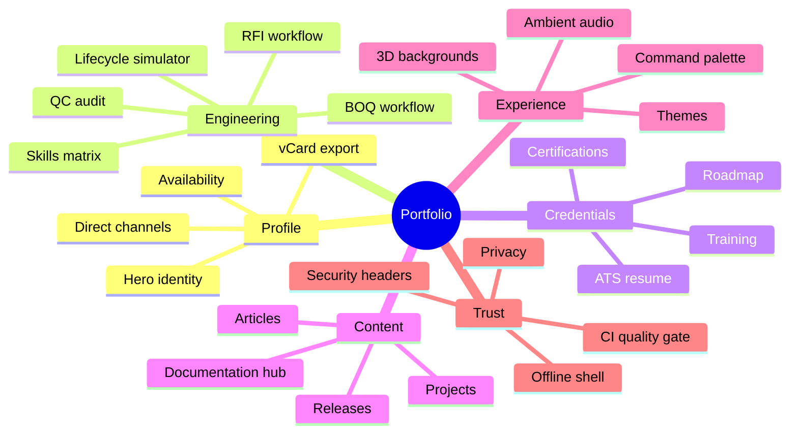

# Feature Matrix

## 24 Product Capabilities

The portfolio combines a professional profile with interactive engineering tools. Every feature is client-side, privacy-preserving and available without an account.

---

## 1. Capability Map

---

## 2. Feature Inventory

| ID | Feature | Category | Status | Implementation |
|:---|:---|:---|:---|:---|
| 01 | Focus Studio 84-sound ambient deck | Audio & Focus | Active | `vibeAudioEngine.ts`, `ProjectVibeModal.tsx` |
| 02 | Dynamic Island live audio bar | Audio & Focus | Active | `Navbar.tsx` |
| 03 | Engineering BOQ and material estimation calculator | Power Tools | Pro Ready | Simulator workflow, `portfolioLogic.ts` |
| 04 | Project schedule and milestone tracking tool | Power Tools | Pro Ready | Simulator stage model |
| 05 | Deep focus Pomodoro sprint timer | Power Tools | Pro Ready | UI state pattern in control center |
| 06 | Technical proposal and engineering scratchpad | Power Tools | Pro Ready | Browser-local editing pattern |
| 07 | Project lifecycle and operations simulator | Data Simulation | Active | `PipelineSimulator.tsx` |
| 08 | RFI and material submittal log sandbox | Data Simulation | Active | Simulator audit query and logs |
| 09 | Autonomous 3D flowing lines engine | 3D & Graphics | Active | `ThreeBackground.tsx` |
| 10 | Five-preset 3D shader customizer | 3D & Graphics | Active | `ThreeBackground.tsx`, control center |
| 11 | 3D tilt and spring elevation cards | 3D & Graphics | Active | Motion hover variants |
| 12 | Studio portrait editorial grader | 3D & Graphics | Pro Ready | `studioAvatar.ts` canvas pipeline |
| 13 | Professional development and training explorer | Search & Filters | Active | `AboutSection.tsx` |
| 14 | Engineering core competencies matrix | Search & Filters | Active | `SkillsSection.tsx` |
| 15 | Command palette and instant search | Search & Filters | Active | `CommandPalette.tsx` |
| 16 | Verified technical deliverables suite | Search & Filters | Active | `ProjectsSection.tsx` |
| 17 | Dual monochrome theme | Controls & Themes | Active | `App.tsx`, `index.css` |
| 18 | Low-transparency crisp liquid glass UI | Controls & Themes | Active | `index.css` |
| 19 | ATS-optimized printable resume | Controls & Themes | Active | `ResumeModal.tsx` |
| 20 | Silent smooth navigation mode | Controls & Themes | Active | `AccountControlsModal.tsx` |
| 21 | Floating rounded mobile slidebar drawer | Accessibility & Mobile | Active | `Navbar.tsx` |
| 22 | Scroll-reactive top bar and bottom dock | Accessibility & Mobile | Active | `Navbar.tsx`, `BottomDock.tsx` |
| 23 | Engineering practice whitepapers reader | Search & Filters | Active | `ArticlesSection.tsx` |
| 24 | Direct collaboration and vCard export | Accessibility & Mobile | Active | `ContactSection.tsx` |

`Pro Ready` means the interaction pattern and supporting logic exist in the codebase; it is not presented as a separate production SaaS product.

---

## 3. Section-by-Section Features

### Hero

- Availability badge for on-site and remote roles.
- Verified completion-rate and quality signals.
- Direct email and LinkedIn channels.
- Primary actions: contact, projects, simulator and resume.
- Engineering credential crest with monochrome identity.
- Tech stack marquee covering the core disciplines.

### About

- Engineering philosophy and operating principles.
- Six KPI cards.
- Four core discipline cards.
- Engineering operations ecosystem table.
- Six competency cards.
- Five interactive blueprint tabs: delivery lifecycle, RFI and submittals, QC gates, BOQ and cost, web architecture.
- Training programs and 2026–2027 roadmap.
- Academic profile.

### Experience

- Two professional engagements with achievements and skill tags.
- Timeline presentation for quick scanning.
- Evidence-oriented descriptions rather than generic responsibilities.

### Projects

- Five engineering deliverables with category filters and text search.
- Metrics and architecture flow for each deliverable.
- Blueprint modal with long-form description.
- Search integration through the command palette.

### Simulator

- Five-stage lifecycle state machine.
- Run/pause control.
- Simulated QC audit with status transitions.
- Live telemetry log.
- Deliverable table.
- Audit query console.
- Completion, deliverables, QC and schedule metrics.

### Certifications

- Ten credentials across engineering, project controls, quality, HSE, BOQ and AI-assisted workflows.
- Category filtering and search.
- Credential identifiers and skill tags.

### Skills

- Six domains: project management, site operations, client management, digital workflows, quality assurance and cost estimation.
- Eight competencies per domain with proficiency indicators.
- Domain-level navigation.

### Articles

- Nine long-form engineering articles.
- Reader modal with multi-paragraph content.
- Tags and sharing.
- Topics covering lifecycle, quality, BOQ, AI, subcontractors, HSE, earned value, handover and risk.

### Documentation and Releases

- Public repository card with license and stack.
- Live-site, source and release links.
- Latest release card with highlights.
- Six documentation entry points.
- Engineering signals for performance, quality and privacy.
- Recruiter FAQ accordion.
- Build signal strip.

### Contact

- Direct email and LinkedIn.
- Copy-to-clipboard email.
- vCard download.
- Pre-filled mailto contact form.
- Clear privacy statement: nothing is stored by the site.

### Global controls

- Onyx Dark and Minimal White themes.
- Five 3D background presets.
- Silent navigation mode.
- Command palette.
- ATS resume.
- Ambient audio mixer.
- Mobile slidebar and bottom dock.
- Back-to-top control.

---

## 4. Interaction Matrix

| Interaction | Mouse | Keyboard | Touch | Persistence |
|:---|:---:|:---:|:---:|:---|
| Navigate sections | Yes | Tab + Enter | Yes | None |
| Open command palette | Click | Ctrl/Cmd + K | Yes | None |
| Toggle theme | Click | Tab + Enter | Yes | localStorage |
| Change 3D preset | Click | Tab + Enter | Yes | localStorage |
| Play ambient audio | Click | Tab + Enter | Yes | Session only |
| Filter projects | Click | Tab + Enter | Yes | None |
| Read article | Click | Tab + Enter | Yes | None |
| Open FAQ | Click | Tab + Enter | Yes | None |
| Download resume | Click | Tab + Enter | Yes | None |
| Download vCard | Click | Tab + Enter | Yes | None |
| Send contact draft | Submit | Enter | Yes | None |

---

## 5. Feature Quality Criteria

A feature is considered complete when:

1. It renders in both themes without contrast regressions.
2. It works at 320px, 768px and 1440px widths.
3. It is reachable by keyboard.
4. It has an accessible name and visible focus treatment.
5. It does not introduce a remote data call or tracking script.
6. It degrades gracefully when WebGL or Web Audio is unavailable.
7. It is documented in this matrix and the README.
8. The production build and test suite pass.

---

## 6. Deferred Capabilities

The following are intentionally deferred and tracked in the roadmap:

- Route-level code splitting for heavy overlays.
- Playwright end-to-end coverage.
- Optional serverless contact endpoint with spam protection.
- Automated accessibility scanning with axe.
- Additional language support and RTL layout.
- A CMS adapter for non-technical content updates.
