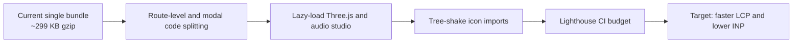

# Performance Profile

## Static, Edge-Delivered, Privacy-First

The application is a static bundle served from Cloudflare Pages. Performance work focuses on bundle size, font loading, GPU discipline and cache correctness.

---

## 1. Current Build Profile

Measured with the production build on Node.js 22 and Vite 8.

| Asset | Raw | Gzip |
|:---|:---:|:---:|
| HTML | ~7.9 KB | ~2.1 KB |
| CSS | ~67 KB | ~11 KB |
| JavaScript | ~1.13 MB | ~299 KB |

The JavaScript bundle includes React 19, Motion, Three.js, Lucide icons and the full application. It is intentionally a single-page experience; route-level code splitting is the next major optimization.

---

## 2. Performance Budget

| Metric | Budget | Current status |
|:---|:---:|:---|
| Initial JS gzip | <= 350 KB | Within budget |
| Initial CSS gzip | <= 20 KB | Within budget |
| HTML | <= 15 KB | Within budget |
| Font families | 3 | Within budget |
| Blocking third-party scripts | 0 | Met |
| Analytics scripts | 0 | Met |
| Layout shift from fonts | Low | Preconnect and fallbacks |
| 3D target | 60 FPS desktop | Preset-dependent |

---

## 3. Optimizations in Place

### Build and delivery

- Vite production minification and tree shaking.
- Hashed asset filenames.
- Immutable caching for `/assets/*`.
- HTML and service worker revalidation.
- Brotli compression at the Cloudflare edge.
- HTTP/3 and TLS 1.3 where supported.

### Fonts

- Preconnect to `fonts.googleapis.com` and `fonts.gstatic.com`.
- Three families with only the required weights.
- System fallbacks for serif, sans-serif and monospace.

### Graphics

- Device pixel ratio clamped for high-DPI devices.
- Animation loop paused when the document is hidden.
- Geometry and materials disposed on unmount.
- Minimal background preset available for low-power devices.

### Audio

- Procedural synthesis avoids downloading audio assets.
- Audio nodes are created only after a user gesture.
- The engine can stop and rebuild the graph without reloading.

### Service worker

- Network-first navigation prevents stale HTML while online.
- Cache-first static assets reduce repeat network cost.
- Explicit cache version enables clean upgrades.

---

## 4. Measurement Procedure

```bash
npm run build
npm run preview
```

Then:

1. Open Chrome DevTools.
2. Run a Lighthouse performance audit in an incognito profile.
3. Record LCP, CLS, INP and total transfer size.
4. Test with Fast 3G throttling.
5. Test on a mid-range mobile device.
6. Repeat with the minimal 3D preset and compare.
7. Check memory after switching presets ten times.

---

## 5. Optimization Roadmap



| Priority | Action | Expected impact |
|:---:|:---|:---|
| High | Dynamically import heavy modals | Lower initial JS |
| High | Lazy-load the audio studio and Three.js scene | Faster first interaction |
| Medium | Replace broad icon imports with direct imports | Smaller bundle |
| Medium | Add Lighthouse CI | Prevent regressions |
| Low | Pre-render static content | Faster first paint without JS |

---

## 6. Performance Risks

| Risk | Mitigation |
|:---|:---|
| Large single bundle | Code splitting roadmap |
| WebGL on low-end devices | Minimal preset and visibility pause |
| Font loading delay | Preconnect and system fallbacks |
| Service worker stale content | Network-first navigation and cache versioning |
| Heavy animations | Silent mode and reduced motion support |

---

## 7. Reporting a Performance Issue

Include:

- Device and browser.
- Network conditions.
- The section or interaction affected.
- Lighthouse or DevTools trace.
- Whether the minimal 3D preset changes the result.

Performance regressions are reviewed against the budget above.
