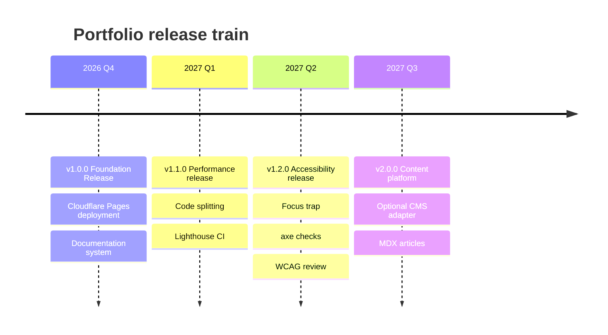

# Roadmap

## Engineering and Product Direction

The roadmap is intentionally small and verifiable. Items move only when they improve the portfolio's usefulness, accessibility, performance or reproducibility.

---

## 1. Release Train

---

## 2. v1.0.0 — Foundation

**Status: Shipped**

- React 19 portfolio with ten sections.
- Project lifecycle and operations simulator.
- 84-sound procedural ambient studio.
- Five 3D background presets.
- Command palette, ATS resume and vCard export.
- Documentation hub and release history.
- Cloudflare Pages deployment.
- CI quality gate and release notes.

---

## 3. v1.1.0 — Performance

**Status: Planned**

| Work item | Outcome |
|:---|:---|
| Dynamic import heavy modals | Reduce initial JavaScript |
| Lazy-load Three.js and audio studio | Faster first interaction |
| Direct icon imports | Smaller icon payload |
| Lighthouse CI budget | Prevent performance regressions |
| Bundle visualizer | Make bundle composition visible |

Success criteria:

- Initial JS gzip under 250 KB.
- Lighthouse performance score of 90+ on desktop.
- No regression in feature availability.

---

## 4. v1.2.0 — Accessibility

**Status: Planned**

| Work item | Outcome |
|:---|:---|
| Shared focus-trap hook | Keyboard containment in modals |
| axe automated scan | Catch semantic regressions |
| Screen-reader pass | Improve announcements and labels |
| Contrast regression checks | Protect both themes |
| Reduced-motion audit | Respect operating-system settings consistently |

Success criteria:

- WCAG 2.2 AA review completed.
- No critical axe violations.
- Keyboard-only journey documented.

---

## 5. v2.0.0 — Content Platform

**Status: Exploratory**

| Work item | Outcome |
|:---|:---|
| MDX article pipeline | Easier long-form publishing |
| Optional CMS adapter | Non-technical content updates |
| Multi-language support | English and Arabic, including RTL |
| Project case-study templates | Consistent deep dives |
| Optional contact endpoint | Serverless delivery with spam protection |

These items are evaluated against the privacy-first constraint. A CMS or contact endpoint would be optional and must not introduce tracking.

---

## 6. Professional Development Track

The portfolio also tracks the owner's engineering development.

| Area | Goal | Horizon |
|:---|:---|:---|
| Certification | PMP — Project Management Professional | 2026–2027 |
| Technical | BIM and digital twins for construction | 2026–2027 |
| Leadership | Senior Project Manager, on-site and remote | Active |
| Digital | AI tools for engineering operations | Active |

---

## 7. How Roadmap Items Are Prioritized

1. Accessibility and correctness.
2. Privacy and security.
3. Performance and reliability.
4. Content clarity for recruiters and clients.
5. New interactive features.
6. Cosmetic enhancements.

An item may be deferred if it conflicts with the static, privacy-first architecture.
