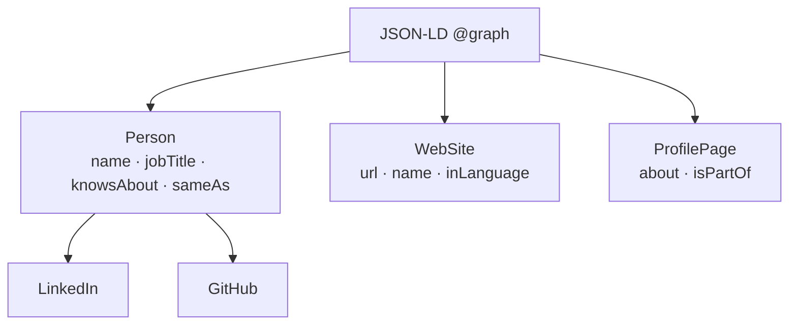

# SEO and Social Metadata

## Discoverability Without Tracking

The portfolio uses standard, privacy-respecting SEO: semantic HTML, a canonical URL, Open Graph and Twitter metadata, JSON-LD structured data, `robots.txt` and a sitemap. It does not use analytics or advertising pixels.

---

## 1. Metadata Inventory

| Element | Location | Purpose |
|:---|:---|:---|
| Title | `index.html` | Search result title |
| Description | `index.html` | Search snippet |
| Canonical | `index.html` | Preferred URL |
| Open Graph | `index.html` | LinkedIn, Facebook, messaging previews |
| Twitter card | `index.html` | X/Twitter preview |
| JSON-LD | `index.html` | Person, WebSite and ProfilePage entities |
| Manifest | `site.webmanifest` | Installable web app metadata |
| Robots | `robots.txt` | Crawl permission and sitemap location |
| Sitemap | `sitemap.xml` | Canonical URL discovery |
| 404 page | `404.html` | Branded error recovery |

---

## 2. Canonical URL

**https://ahmed-khaled-technical-operations-portfolio.pages.dev/**

If a custom domain is added:

1. Update the canonical link.
2. Update `og:url`, `og:image` and `twitter:image`.
3. Update the JSON-LD `@id` values.
4. Update `robots.txt` and `sitemap.xml`.
5. Add a redirect from the old URL if appropriate.

---

## 3. Structured Data

The graph describes the person, the website and the profile page. It deliberately avoids invented credentials, ratings or review markup.

---

## 4. Social Preview

- Image: `/og-image.png`
- Dimensions: 1200x630
- Format: PNG
- Alt text: "Ahmed Khaled — Technical Operations Portfolio"
- Card type: `summary_large_image`

Preview checklist:

- Title is readable at small sizes.
- Subtitle explains the professional focus.
- Monogram and URL are visible.
- No text is clipped at 1200x630.

---

## 5. Content SEO

- One `h1` per page in the hero.
- Section headings follow a logical hierarchy.
- Descriptive link text rather than "click here".
- Articles contain long-form, topic-specific copy.
- Project and credential titles use the language a recruiter would search for.
- The FAQ answers common role, privacy and deployment questions.

---

## 6. Technical SEO Checklist

- [ ] Canonical URL is correct.
- [ ] `robots.txt` allows crawling and points to the sitemap.
- [ ] `sitemap.xml` contains the canonical URL.
- [ ] 404 page returns the correct status and offers navigation.
- [ ] Social image is reachable and correctly sized.
- [ ] JSON-LD parses without errors.
- [ ] Page title and description are unique and descriptive.
- [ ] No accidental `noindex` on the production page.
- [ ] Language is declared as `en`.
- [ ] The site works without JavaScript for the basic profile message.

---

## 7. Verification Tools

- Google Rich Results Test for JSON-LD.
- LinkedIn Post Inspector for Open Graph.
- X Card Validator for Twitter metadata.
- Browser DevTools network panel for asset and header checks.
- `curl` for robots and sitemap responses.

---

## 8. Privacy Boundary

SEO metadata is public by definition. It contains only professional information already presented on the page. No visitor data is collected, and no analytics or advertising scripts are present.
