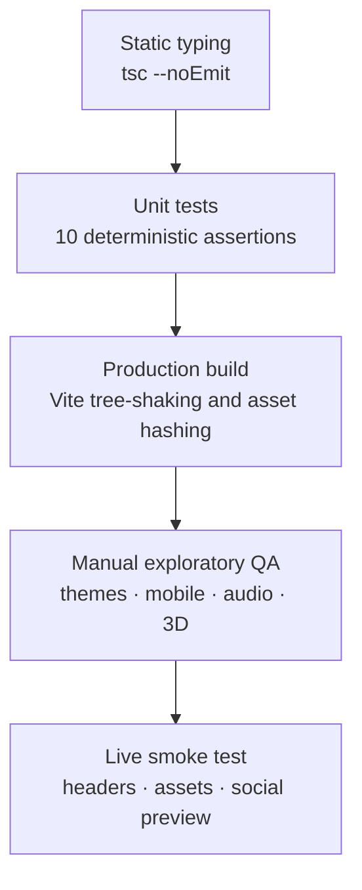

# Testing and Quality Assurance

## Quality Gate for the Portfolio

The project uses a layered quality strategy: static typing, deterministic unit tests, a production build check, manual browser QA and a live smoke test after deployment.

---

## 1. Test Pyramid



---

## 2. Commands

```bash
npm ci
npm run lint
npm test
npm run build
npm run preview
npm run verify
```

`npm run verify` runs typecheck, tests and build in sequence.

---

## 3. Unit Test Inventory

The test suite lives in `src/utils/portfolioLogic.test.ts` and uses the Node.js test runner through `tsx`.

| Test | Behaviour verified |
|:---|:---|
| Category filter | Projects filter correctly by category |
| Text search | Search matches title, description and tags |
| Credential filter | Credentials filter by issuer and query |
| Statistics | Totals and verified counts are calculated correctly |
| Credential formatting | Long identifiers are shortened deterministically |
| Cluster sizing | Throughput, storage and infrastructure recommendations remain bounded |
| JSON schema generation | PySpark and SQL DDL are generated from a JSON sample |
| Invalid JSON handling | Invalid input returns a structured error |
| Scrollbar metrics | Thumb height and position remain bounded |
| Motion variants | Stagger delays remain within the configured bounds |

Run with:

```bash
npm test
```

Expected result: **10 tests, 10 pass, 0 fail**.

---

## 4. Manual QA Matrix

### Desktop

| Area | Check | Expected |
|:---|:---|:---|
| Hero | Identity, badges, actions | Renders without overlap at 1440px |
| Navbar | Section links and scrollspy | Active pill follows the current section |
| Theme | Dark to light and back | No unreadable text or broken borders |
| Projects | Filter and search | Cards update without layout jumps |
| Simulator | Run, pause and QC audit | Metrics and logs update predictably |
| Articles | Open and close reader | Content is readable and scrollable |
| Docs | Repository, release and FAQ | Links are correct and FAQ toggles |
| Contact | Submit form | Mail client opens with a pre-filled draft |
| Footer | Source, docs and release links | Open the correct destinations |
| Command palette | Ctrl/Cmd + K | Opens, filters and navigates |

### Mobile

| Area | Check | Expected |
|:---|:---|:---|
| Top bar | Brand, audio, theme, menu | Fits without horizontal page overflow |
| Section pills | Horizontal scroll | All sections remain reachable |
| Slidebar | Open and close | Panel fits within the viewport |
| Hero | Title, tagline, actions | Text wraps cleanly |
| Bottom dock | Section shortcuts | Does not block critical controls |
| Contact | Form fields | Inputs remain usable above the keyboard |
| Resume | Print layout | Readable on A4 |

### Browser support

| Browser | Version | Status |
|:---|:---|:---|
| Chrome / Edge | Current | Primary target |
| Firefox | Current | Supported |
| Safari | 16+ | Supported; verify audio gestures |
| Mobile Safari | iOS 16+ | Supported; verify viewport and audio |
| Chrome Android | Current | Supported |

WebGL and Web Audio are progressive enhancements. The site remains readable if either is unavailable.

---

## 5. Accessibility Checks

- Tab through every interactive element in a logical order.
- Confirm a visible focus indicator.
- Operate the command palette with the keyboard only.
- Confirm modals can be closed with Escape or the close button.
- Verify headings follow a sensible hierarchy.
- Check both themes at 200% browser zoom.
- Enable reduced motion at the operating-system level and confirm the experience remains usable.
- Confirm the FAQ uses `aria-expanded`.
- Confirm images and icons have appropriate alternative text or are decorative.

See [ACCESSIBILITY.md](ACCESSIBILITY.md) for the full standard.

---

## 6. Performance Checks

- Inspect the production bundle size after `npm run build`.
- Confirm hashed assets receive immutable cache headers.
- Test on a throttled connection.
- Confirm the service worker does not serve stale HTML while online.
- Verify the 3D background pauses when the tab is hidden.
- Check memory after switching 3D presets repeatedly.

See [PERFORMANCE.md](PERFORMANCE.md) for budgets.

---

## 7. Deployment Smoke Test

```bash
curl -I https://ahmed-khaled-technical-operations-portfolio.pages.dev/
curl -s https://ahmed-khaled-technical-operations-portfolio.pages.dev/robots.txt
curl -s https://ahmed-khaled-technical-operations-portfolio.pages.dev/sitemap.xml
```

Confirm:

- HTTP 200 on the homepage.
- `Content-Security-Policy`, `X-Frame-Options`, `X-Content-Type-Options` and `Referrer-Policy` are present.
- `og-image.png` loads and is 1200x630.
- `sw.js` is served with revalidation.
- `assets/*` is served with immutable caching.
- No console errors in a fresh browser profile.

---

## 8. Release Checklist

- [ ] Working tree is clean.
- [ ] `npm run verify` passes.
- [ ] Changelog is updated.
- [ ] Version is updated in `package.json` and `REPOSITORY`.
- [ ] Service worker cache version is incremented for major changes.
- [ ] README and docs reflect the release.
- [ ] Deployment succeeds.
- [ ] Live smoke test passes.
- [ ] GitHub release is published.
- [ ] Repository topics and homepage are current.

---

## 9. Future Test Work

| Item | Priority | Notes |
|:---|:---:|:---|
| Playwright smoke suite | High | Hero, navigation, simulator, contact draft |
| axe accessibility scan | High | Run in CI against the built site |
| Visual regression snapshots | Medium | Both themes and mobile widths |
| Lighthouse CI budget | Medium | Performance and accessibility thresholds |
| Unit tests for new calculators | Medium | BOQ, schedule variance and risk scoring |
